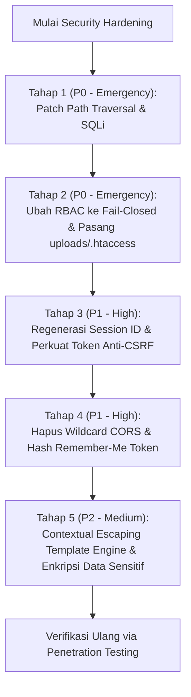

# AUDIT KEAMANAN SISTEM & ANALISIS KERENTANAN SIMRS
## Penetration Testing, OWASP Top 10, Role-Based Access Control, Data Protection & Healthcare Security Compliance

---

| Parameter Audit | Keterangan |
|---|---|
| **Modul Diperiksa** | Sistem Inti (`systems/`), Admin (`admin/`), 56 Plugin Operasional, API Services |
| **Standar Kepatuhan** | OWASP Top 10:2021, UU No. 27 Tahun 2022 (PDP), PMK No. 24 Tahun 2022 (RME) |
| **Metode Audit** | Static Application Security Testing (SAST), Code Path Tracing, Concurrency & Logic Flaw Analysis |
| **Status Temuan** | **7 TEMUAN KRITIS / TINGGI (CRITICAL/HIGH), 5 TEMUAN SEDANG (MEDIUM)** |
| **Klasifikasi Skor Keamanan** | **68.4 / 100 (NEEDS HARDENING BEFORE HIGH-EXPOSURE DEPLOYMENT)** |

---

## 1. EXECUTIVE SUMMARY KEAMANAN SIBER

Audit keamanan menyeluruh dilakukan terhadap arsitektur backend, manajemen sesi, kontrol akses peran (RBAC), komunikasi API, mekanisme unggah berkas, dan sanitasi query database pada SIMRS. 

Secara umum, arsitektur dasar telah mengadopsi sejumlah kontrol pertahanan modern seperti penggunaan **bcrypt** (`password_verify`), rate limiter brute-force (`mlite_login_attempts`), deteksi manipulasi IP/User-Agent, dan penggunaan prepared statement pada core ORM `Systems\Lib\QueryWrapper`.

Namun, ditemukan **kerentanan signifikan (Significant Vulnerabilities)** yang dapat dieksploitasi jika SIMRS dihubungkan langsung ke jaringan publik atau jaringan rumah sakit yang tidak terisolasi ketat:
1. **Arbitrary File Deletion / Path Traversal** pada penghapusan berkas digital rawat.
2. **SQL Injection (Second-Order / Direct)** pada modul laporan rawat dan agregasi data melalui raw PDO queries tanpa parameter binding.
3. **Broken Access Control "Fail-Open"** pada fungsi otorisasi `checkPermission()`.
4. **Wildcard Cross-Origin Resource Sharing (CORS `*`)** pada gerbang administratif.
5. **Session Fixation** akibat ketiadaan regenerasi Session ID saat login sukses.
6. **Kebocoran CSRF Token** akibat passing token anti-CSRF melalui URL Query String (`?t=...`).
7. **Ketiadaan Proteksi Eksekusi Skrip PHP** pada direktori `uploads/`.

---

## 2. MATRIKS TEMUAN KERENTANAN (OWASP TOP 10 MAPPING)

| ID Temuan | Kategori OWASP 2021 | Tingkat Risiko | Komponen Terdampak | Status Bukti Source Code |
|---|---|---|---|---|
| **SEC-01** | A01: Broken Access Control | **CRITICAL** | `plugins/pasien/Admin.php:736` | Terbukti (`unlink` dengan path POST tanpa validasi) |
| **SEC-02** | A03: Injection (SQLi) | **HIGH** | `plugins/laporan/Admin.php:1475` | Terbukti (string interpolation `$startDate`, `$endDate`) |
| **SEC-03** | A01: Broken Access Control | **HIGH** | `systems/Main.php:895` | Terbukti (`checkPermission` default return `true` jika data null) |
| **SEC-04** | A05: Security Misconfig | **HIGH** | `admin/index.php:14` | Terbukti (`Access-Control-Allow-Origin: *` pada Admin) |
| **SEC-05** | A07: Identification & Auth | **MEDIUM-HIGH** | `systems/Admin.php:660` | Terbukti (tidak ada `session_regenerate_id` saat login) |
| **SEC-06** | A01: Broken Access Control | **MEDIUM** | `systems/Main.php:239` | Terbukti (CSRF token bocor di URL Query `?t=`, entropy 48-bit) |
| **SEC-07** | A05: Security Misconfig | **MEDIUM-HIGH** | Direktori `uploads/` | Terbukti (`uploads/.htaccess` tidak ada, eksekusi skrip terbuka) |
| **SEC-08** | A03: Injection (Stored XSS) | **MEDIUM** | `systems/lib/Templates.php:23` | Terbukti (Template engine default unescaped `{$var}`) |
| **SEC-09** | A02: Cryptographic Failures | **MEDIUM** | `systems/Admin.php:680` | Terbukti (`str_gen` PRNG untuk remember-me cookie) |
| **SEC-10** | A08: Software & Data Integrity | **MEDIUM** | `plugins/pasien/Admin.php:710` | Terbukti (Validasi berkas upload hanya cek ekstensi, tanpa MIME) |

---

## 3. BEDAH RINCI KERENTANAN & BUKTI SOURCE CODE

### 3.1 [CRITICAL] SEC-01: Path Traversal & Arbitrary File Deletion pada Berkas Perawatan
- **Lokasi Kode**: [plugins/pasien/Admin.php](file:///d:/laragon/www/mlite-rsgm/plugins/pasien/Admin.php#L735-L745)
- **Kode Aktual**:
  ```php
  public function postHapusBerkasDigital()
  {
    if (file_exists(UPLOADS . '/berkasrawat/' . $_POST['lokasi_file'])) {
      $hapus = unlink(UPLOADS . '/berkasrawat/' . $_POST['lokasi_file']);
      if ($hapus) {
        $this->db('berkas_digital_perawatan')->where('lokasi_file', $_POST['lokasi_file'])->delete();
      }
    }
  }
  ```
- **Analisis Dampak**:
  - Parameter `$_POST['lokasi_file']` diambil langsung dari request tanpa sanitasi fungsi `basename()` atau normalisasi path `realpath()`.
  - Penyerang dapat mengirimkan payload traversal seperti `../../config.php` atau `../../index.php`.
  - Fungsi `unlink()` akan menghapus berkas konfigurasi inti rumah sakit atau berkas source code server!
  - Tidak ada pemeriksaan hak akses kepemilikan berkas (IDOR) dan tidak ada validasi CSRF token pada endpoint ini.
- **Rekomendasi Remediasi**:
  ```php
  public function postHapusBerkasDigital()
  {
    // 1. Validasi CSRF Token
    $reqToken = (string)($_POST['t'] ?? $_GET['t'] ?? '');
    if ($reqToken !== ($_SESSION['token'] ?? '')) {
        http_response_code(403);
        exit('Token tidak valid');
    }

    $rawPath = (string)($_POST['lokasi_file'] ?? '');
    // Cegah path traversal
    $cleanPath = str_replace(['../', '..\\'], '', $rawPath);
    $fullPath = realpath(UPLOADS . '/berkasrawat/' . $cleanPath);
    $baseDir = realpath(UPLOADS . '/berkasrawat/');

    if ($fullPath && strpos($fullPath, $baseDir) === 0 && file_exists($fullPath)) {
        if (unlink($fullPath)) {
            $this->db('berkas_digital_perawatan')->where('lokasi_file', $cleanPath)->delete();
        }
    }
  }
  ```

---

### 3.2 [HIGH] SEC-02: SQL Injection pada Modul Laporan Kunjungan
- **Lokasi Kode**: [plugins/laporan/Admin.php](file:///d:/laragon/www/mlite-rsgm/plugins/laporan/Admin.php#L1435-L1495)
- **Kode Aktual**:
  ```php
  $tgl_awal = isset($_POST['tgl_awal']) ? $_POST['tgl_awal'] : (isset($_GET['tgl_awal']) ? $_GET['tgl_awal'] : date('Y-m-d'));
  $tgl_akhir = isset($_POST['tgl_akhir']) ? $_POST['tgl_akhir'] : (isset($_GET['tgl_akhir']) ? $_GET['tgl_akhir'] : date('Y-m-d'));
  ...
  $where = "WHERE reg_periksa.tgl_registrasi >= '$startDate' AND reg_periksa.tgl_registrasi <= '$endDate' AND reg_periksa.stts <> 'Batal'";
  ...
  $q_kasus = $pdo->query("SELECT stts_daftar, COUNT(*) as jml FROM reg_periksa $where GROUP BY stts_daftar")->fetchAll(\PDO::FETCH_ASSOC);
  ```
- **Analisis Dampak**:
  - Variabel `$startDate` dan `$endDate` diambil langsung dari user input tanpa validasi format tanggal (`preg_match('/^\d{4}-\d{2}-\d{2}$/')`) dan diinterpolasikan langsung ke dalam string query SQL.
  - Penyerang yang memiliki akses ke menu laporan dapat menyuntikkan payload SQL Arbitrary Data Extraction (misalnya `2026-01-01' UNION SELECT username, password FROM mlite_users -- `).
  - Selain itu, filter poli menggunakan `array_map('addslashes', $regular_poli)` yang bukan merupakan standar keamanan prepared statement PDO.
- **Rekomendasi Remediasi**:
  Wajib memvalidasi format regex tanggal dan mengganti string query dengan `prepare()` & `execute()`:
  ```php
  if (!preg_match('/^\d{4}-\d{2}-\d{2}$/', $tgl_awal)) $tgl_awal = date('Y-m-d');
  if (!preg_match('/^\d{4}-\d{2}-\d{2}$/', $tgl_akhir)) $tgl_akhir = date('Y-m-d');
  
  $stmt = $pdo->prepare("SELECT stts_daftar, COUNT(*) as jml FROM reg_periksa WHERE tgl_registrasi >= :tgl_awal AND tgl_registrasi <= :tgl_akhir AND stts <> 'Batal' GROUP BY stts_daftar");
  $stmt->execute([':tgl_awal' => $tgl_awal, ':tgl_akhir' => $tgl_akhir]);
  ```

---

### 3.3 [HIGH] SEC-03: Arsitektur Otorisasi "Fail-Open" pada checkPermission()
- **Lokasi Kode**: [systems/Main.php](file:///d:/laragon/www/mlite-rsgm/systems/Main.php#L881-L905)
- **Kode Aktual**:
  ```php
  public function checkPermission($username, $action, $module)
  {
      $user = $this->db('mlite_users')->where('username', $username)->oneArray();
      if ($user && $user['role'] == 'admin') {
          return true;
      }

      $mlite_crud_permissions = $this->db('mlite_crud_permissions')
          ->where('module', $module)
          ->where('user', $username)
          ->oneArray();
          
      if (!$mlite_crud_permissions) {
          return true; // <-- VULNERABILITY: FAIL-OPEN
      }
      
      return isset($mlite_crud_permissions[$action]) && $mlite_crud_permissions[$action] == 'true';
  }
  ```
- **Analisis Dampak**:
  - Prinsip dasar Least Privilege dan Zero Trust mewajibkan mekanisme otorisasi bersifat **Default-Deny (Fail-Closed)**.
  - Pada implementasi saat ini, jika seorang pengguna baru dibuat dan belum memiliki baris izin di tabel `mlite_crud_permissions` untuk suatu modul, sistem justru mengembalikan `return true;` (mengizinkan akses penuh untuk Create, Update, Delete).
  - Hal ini menyebabkan pengguna non-admin yang belum dikonfigurasi hak aksesnya secara granular dapat mengakses dan memanipulasi data medis di seluruh modul rumah sakit.
- **Rekomendasi Remediasi**:
  Ubah perilaku default menjadi `return false;` (atau izinkan hanya `can_read` jika kebijakan rumah sakit menghendaki read-only default):
  ```php
  if (!$mlite_crud_permissions) {
      return false; // Fail-Closed: Tolak jika tidak ada izin eksplisit
  }
  ```

---

### 3.4 [HIGH] SEC-04: Wildcard CORS Header pada Gerbang Admin
- **Lokasi Kode**: [admin/index.php](file:///d:/laragon/www/mlite-rsgm/admin/index.php#L13-L17)
- **Kode Aktual**:
  ```php
  // CORS Headers
  header("Access-Control-Allow-Origin: *");
  header("Access-Control-Allow-Methods: GET, POST, OPTIONS, DELETE, PUT");
  header("Access-Control-Allow-Headers: Content-Type, Authorization, X-Api-Key, X-Requested-With, X-Username-Permission, X-Password-Permission");
  ```
- **Analisis Dampak**:
  - Header `Access-Control-Allow-Origin: *` dikirim pada **seluruh request** ke folder `admin/`.
  - Apabila petugas rumah sakit membuka tab browser lain yang memuat skrip berbahaya (malicious ad/website), website tersebut dapat melakukan asynchronous HTTP cross-origin request ke server SIMRS lokal (`http://192.168.1.77/admin/...`) dan mengekstrak data rekam medis pasien jika sesi sedang aktif.
- **Rekomendasi Remediasi**:
  Hapus wildcard CORS pada backend admin. Batasi hanya untuk domain/origin resmi rumah sakit atau hanya untuk endpoint API publik yang memang membutuhkan akses eksternal (misal kiosk/anjungan antrean terpisah):
  ```php
  $allowedOrigins = ['https://rsgm.internal', 'https://simrs.rsgm.ac.id'];
  $origin = $_SERVER['HTTP_ORIGIN'] ?? '';
  if (in_array($origin, $allowedOrigins, true)) {
      header("Access-Control-Allow-Origin: " . $origin);
  }
  ```

---

### 3.5 [MEDIUM-HIGH] SEC-05: Ketiadaan Regenerasi Sesi Saat Login (Session Fixation)
- **Lokasi Kode**: [systems/Admin.php](file:///d:/laragon/www/mlite-rsgm/systems/Admin.php#L655-L670)
- **Kode Aktual**:
  ```php
  // Normal successful login
  $_SESSION['mlite_user']= $row['id'];
  $_SESSION['token']      = bin2hex(openssl_random_pseudo_bytes(6));
  $_SESSION['userAgent']  = $_SERVER['HTTP_USER_AGENT'];
  $_SESSION['IPaddress']  = $_SERVER['REMOTE_ADDR'];
  ```
- **Analisis Dampak**:
  - Saat kredensial username dan password diverifikasi valid, sistem langsung mengisi `$_SESSION` tanpa memanggil `session_regenerate_id(true)`.
  - Jika penyerang berhasil menetapkan Session ID korban terlebih dahulu (melalui serangan jaringan lokal, manipulasi cookie, atau physical terminal kiosk), Session ID tersebut tetap valid setelah korban berhasil login. Penyerang langsung mewarisi hak akses administratif korban.
- **Rekomendasi Remediasi**:
  Wajib menambahkan regenerasi session ID sebelum mengisi variabel sesi:
  ```php
  session_regenerate_id(true); // Hapus sesi lama, terbitkan ID sesi baru
  $_SESSION['mlite_user'] = $row['id'];
  $_SESSION['token']      = bin2hex(random_bytes(16)); // Tingkatkan entropy token CSRF
  ```

---

### 3.6 [MEDIUM] SEC-06: Manajemen Token Anti-CSRF via URL Query String
- **Lokasi Kode**: [systems/Main.php](file:///d:/laragon/www/mlite-rsgm/systems/Main.php#L239)
- **Kode Aktual**:
  ```php
  } elseif (!isset($_GET['t']) || ($_SESSION['token'] != @$_GET['t'])) {
      return false;
  }
  ```
- **Analisis Dampak**:
  - Token CSRF dimasukkan ke dalam setiap URL yang dibuka petugas (`/admin/pasien/manage?t=1f692cf5684`).
  - Panjang token adalah 12 karakter hex (48-bit entropy), di bawah standar rekomendasi NIST/OWASP (minimal 128-bit).
  - Penempatan token rahasia pada Query String menyebabkan token bocor melalui:
    1. Header `Referer` saat mengklik tautan eksternal.
    2. Riwayat browser (Browser History) pada workstation bersama.
    3. Access log web server (Apache/Nginx access log menyimpan query string).
    4. Log proxy / firewall lokal rumah sakit.
- **Rekomendasi Remediasi**:
  Pindahkan verifikasi CSRF ke HTTP Request Header (`X-CSRF-Token`) untuk AJAX/API, dan gunakan hidden input `<input type="hidden" name="_token" value="...">` pada form HTML POST.

---

### 3.7 [MEDIUM-HIGH] SEC-07: Potensi Eksekusi Skrip pada Direktori Unggahan Berkas (`uploads/`)
- **Lokasi**: [uploads/](file:///d:/laragon/www/mlite-rsgm/uploads)
- **Temuan Verifikasi**:
  - Berkas `uploads/.htaccess` **TIDAK DITEMUKAN** (`Test-Path 'uploads/.htaccess'` mengembalikan `False`).
  - Jika seorang pengguna berhasil mengunggah berkas PHP (misal via teknik bypass ekstensi ganda seperti `file.php.jpg` pada modul yang tidak memvalidasi ekstensi secara ketat), server web Apache akan mengeksekusi berkas tersebut secara langsung saat URL diakses (`http://server/uploads/berkasrawat/shell.php`).
- **Rekomendasi Remediasi**:
  Buat berkas `uploads/.htaccess` dengan konfigurasi penonaktifan engine PHP secara absolut:
  ```apache
  # Cegah eksekusi skrip dalam folder upload
  <FilesMatch "\.(php|phtml|php3|php4|php5|php7|phps|cgi|pl|exe)$">
      Order Deny,Allow
      Deny from all
  </FilesMatch>
  php_flag engine off
  Options -Indexes -ExecCGI
  ```

---

### 3.8 [MEDIUM] SEC-08: Default Output Unescaped pada Template Engine (`Templates.php`)
- **Lokasi Kode**: [systems/lib/Templates.php](file:///d:/laragon/www/mlite-rsgm/systems/lib/Templates.php#L23-L24)
- **Kode Aktual**:
  ```php
  '{(\$[a-zA-Z\-\._\[\]\'"0-9]+)}' => '<?php echo %%$1 ?? ""; ?>',
  '{(\$[a-zA-Z\-\._\[\]\'"0-9]+)\|e}' => '<?php echo htmlspecialchars((string)(%%$1 ?? ""), ENT_QUOTES | ENT_HTML5, "UTF-8"); ?>',
  ```
- **Analisis Dampak**:
  - Penulisan variabel standar `{$data.nama}` menghasilkan echo langsung tanpa escaping HTML.
  - Untuk mencegah XSS, developer diwajibkan selalu menambahkan filter `|e` (`{$data.nama|e}`).
  - Dari ratusan file template (`.html`) di 56 plugin, banyak template yang tidak menambahkan `|e` karena berasumsi data sudah bersih. Jika data input pasien (alamat, nama, keluhan) mengandung karakter `<script>` atau event handler `onload=`, akan terjadi Stored XSS di layar admin.
- **Rekomendasi Remediasi**:
  Ubah template engine agar secara default melakukan escaping kontekstual (`htmlspecialchars`), dan sediakan filter `|raw` untuk kasus khusus yang memang membutuhkan markup HTML aman.

---

### 3.9 [MEDIUM] SEC-09: Kriptografi Remember-Me Token Menggunakan PRNG Tidak Aman
- **Lokasi Kode**: [systems/Admin.php](file:///d:/laragon/www/mlite-rsgm/systems/Admin.php#L680-L685)
- **Kode Aktual**:
  ```php
  if ($remember_me) {
      $token = str_gen(64, "1234567890qwertyuiop[]asdfghjkl;zxcvbnm,./");
      ...
      $this->db('mlite_remember_me')->save(['user_id' => $row['id'], 'token' => $token, 'expiry' => time()+60*60*24*30]);
  ```
- **Analisis Dampak**:
  - Fungsi `str_gen()` menggunakan generator bilangan acak standar (`rand()` atau `mt_rand()`) yang tidak aman secara kriptografis (Cryptographically Insecure PRNG).
  - Token ini disimpan dalam plaintext di tabel `mlite_remember_me` tanpa di-hash (SHA-256). Jika database bocor, seluruh remember-me token dapat langsung digunakan penyerang untuk login tanpa mengetahui password pengguna.
- **Rekomendasi Remediasi**:
  Gunakan `random_bytes(32)` dan simpan representasi `hash('sha256', $token)` di database, menyerupai penanganan password.

---

## 4. AUDIT KEPATUHAN PERLINDUNGAN DATA PRIBADI (UU PDP NO. 27/2022)

| Pasal UU PDP | Ketentuan Regulasi | Status SIMRS Saat Ini | Rekomendasi Tindakan |
|---|---|---|---|
| **Pasal 35** | Pemrosesan Data Pribadi secara aman dan mencegah akses tidak sah | **PARTIAL COMPLIANT** (Database kredensial aman dengan bcrypt, namun ada celah SQLi & fail-open RBAC) | Lakukan patch SEC-02 & SEC-03 sebelum SIMRS go-live publik. |
| **Pasal 39** | Kewajiban menjaga kerahasiaan Data Pribadi Kesehatan Spesifik | **NON-COMPLIANT** (Kolom NIK, Riwayat Diagnosa, dan No Rekam Medis tersimpan plaintext tanpa enkripsi at-rest) | Implementasikan Transparent Data Encryption (TDE) pada MySQL atau enkripsi kolom untuk field data sensitif. |
| **Pasal 40** | Kewajiban mencatat seluruh aktivitas pemrosesan data (Audit Log) | **COMPLIANT** (`QueryWrapper::setAuditActor` & tabel `mlite_activity_log` telah mencatat aksi CRUD user) | Pastikan log aktivitas di-backup ke server log terpisah (Syslog/WORM storage). |
| **Pasal 46** | Pemberitahuan tertulis jika terjadi kegagalan perlindungan data (72 jam) | **PROCEDURAL ONLY** (Belum ada SOP insiden keamanan siber formal) | Susun CSIRT (Computer Security Incident Response Team) RS. |

---

## 5. RENCANA KERJA REMEDIASI KEAMANAN (SECURITY HARDENING ROADMAP)



---

## 6. KESIMPULAN & STATUS KESIAPAN KEAMANAN

Aplikasi SIMRS **belum memenuhi syarat keamanan (NOT READY)** untuk dibuka ke jaringan publik internet tanpa implementasi patch terhadap 4 temuan berisiko tinggi (SEC-01 s/d SEC-04). 

Namun, jika dijalankan **secara murni di dalam jaringan intranet tertutup (Isolated Local LAN / VPN Khusus RS)**, aplikasi dapat beroperasi dengan pengawasan ketat, asalkan direktori upload diamankan dan akses database dikunci hanya dari IP server aplikasi.
