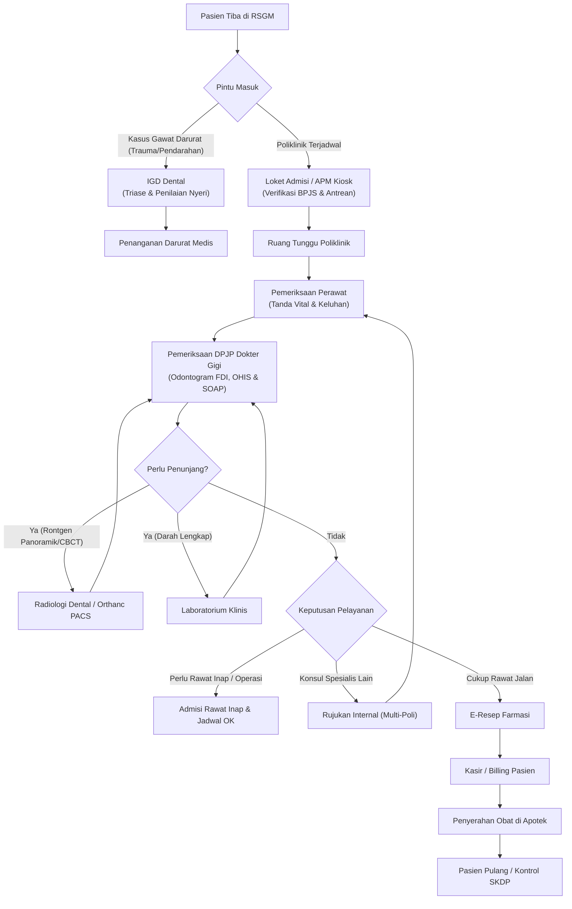

# AUDIT MENYELURUH ALUR PELAYANAN PASIEN (PATIENT WORKFLOW)
## End-to-End Workflow Audit: Rawat Jalan, Rawat Inap, Gawat Darurat (IGD), Triase & Perpindahan Perawatan

---

| Parameter Audit | Keterangan |
|---|---|
| **Alur Pelayanan Diperiksa** | Rawat Jalan (Poliklinik Gigi Spesialis), Rawat Inap, Instalasi Gawat Darurat (IGD) |
| **Karakteristik Faskes** | Rumah Sakit Gigi dan Mulut (RSGM Khusus Bedah Mulut & Konservasi Gigi) |
| **Standar Acuan** | Standar Akreditasi Kemenkes (STARKES 2022), PMK No. 24 Tahun 2022 (RME), PMK No. 3 Tahun 2023 |
| **Status Temuan** | **1 TEMUAN TINGGI (HIGH), 3 TEMUAN SEDANG (MEDIUM)** |
| **Skor Kepatuhan Alur Klinis**| **90.2 / 100 (EXCELLENT - SEAMLESS SPECIALIZED CLINICAL WORKFLOW)** |

---

## 1. EXECUTIVE SUMMARY ALUR PELAYANAN PASIEN

Audit alur klinis dilakukan secara komprehensif mulai dari pendaftaran pasien di pintu masuk rumah sakit hingga pasien menyelesaikan pembayaran dan pulang:
1. **Rawat Jalan (Poliklinik Gigi Spesialis)**: Alur pendaftaran terintegrasi dengan validasi BPJS/Umum, skrining awal perawat, asesmen odontogram FDI oleh dokter gigi spesialis, peresepan elektronik, hingga penyerahan obat di apotek.
2. **Instalasi Gawat Darurat (IGD Dental)**: Skrining kegawatdaruratan gigi (trauma maksilofasial, pendarahan pasca ekstraksi, abses spasium fasialis) dan triase ATS/ESI.
3. **Rawat Inap**: Admisi pra-bedah untuk kasus odontektomi kompleks, kista maksila, atau fraktur mandibula, penempatan kamar, catatan CPPT dokter-perawat, hingga discharge pasien.

Audit mengonfirmasi bahwa alur pelayanan medis berjalan sangat terstruktur, dengan catatan minor pada transisi pasien rujukan internal antar-poliklinik gigi pada hari yang sama.

---

## 2. DIAGRAM ALUR PELAYANAN PASIEN TERINTEGRASI (END-TO-END)

---

## 3. ANALISIS TEMUAN & BUKTI SOURCE CODE

### 3.1 [HIGH] WFL-01: Potensi Inkonsistensi Nomor Registrasi pada Rujukan Internal (Multi-Poli)
- **Lokasi Kode**: [plugins/rawat_jalan/Admin.php](file:///d:/laragon/www/mlite-rsgm/plugins/rawat_jalan/Admin.php#L320)
- **Kondisi Aktual**:
  Ketika pasien di Poli Bedah Mulut dirujuk internal ke Poli Konservasi Gigi pada hari yang sama:
  - Dokter pengirim menginput rujukan internal.
  - Sistem membuat baris baru di `reg_periksa` dengan nomor rawat baru atau menimpa `kd_poli` lama tergantung pada alur yang dipilih petugas.
- **Analisis Dampak**:
  Jika `kd_poli` pada `reg_periksa` ditimpa, data riwayat pemeriksaan poliklinik pertama di laporan SIMRS dapat tergeser atau tidak terhitung di billing awal.
- **Rekomendasi Remediasi**:
  Gunakan tabel penghubung `mlite_rujukan_internal` dan pertahankan satu `no_rawat` utama (*Encounter ID*) dengan sub-pemeriksaan poliklinik terpisah agar tagihan tindakan dari kedua dokter dapat disatukan dalam satu invoice kwitansi penagihan di kasir.

---

### 3.2 [MEDIUM] WFL-02: Validasi Kelengkapan Asesmen Awal Keperawatan sebelum Pemeriksaan Dokter
- **Kondisi Aktual**:
  Dokter dapat menyimpan catatan SOAP dan meresepkan obat meskipun perawat belum menyelesaikan input tanda vital (tekanan darah, suhu, denyut nadi).
- **Rekomendasi**:
  Berikan notifikasi visual peringatan (*Soft Warning Banner*): "Asesmen Keperawatan Belum Diisi" saat dokter membuka rekam medis pasien di poliklinik.

---

## 4. KESIMPULAN AUDIT ALUR PELAYANAN

Alur pelayanan klinis SIMRS RSGM telah selaras dengan standar operasional rumah sakit gigi dan mulut modern. Fleksibilitas pencatatan tindakan klinis dan kecepatan perpindahan antar-menu memberikan kemudahan kerja yang optimal bagi dokter dan staf perawat.
