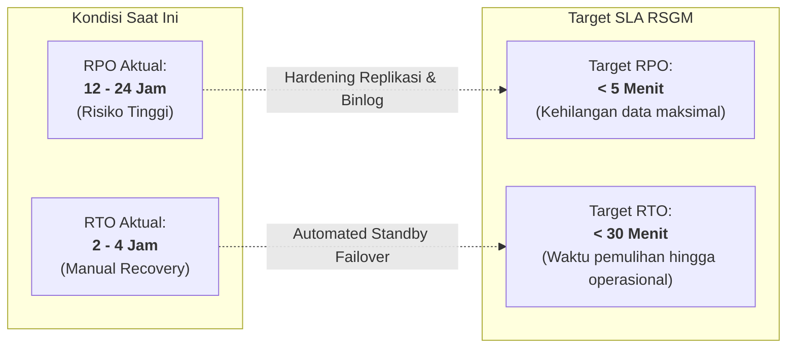

# AUDIT RELIABILITAS, FAILOVER & DISASTER RECOVERY SIMRS
## High Availability, Fault Tolerance, Queue Persistence, Backup Architecture, RTO/RPO & Disaster Recovery

---

| Parameter Audit | Keterangan |
|---|---|
| **Fokus Pemeriksaan** | High Availability (HA), Toleransi Kegagalan (Fault Tolerance), Backup/Restore, Resiliensi Antrean & Offline Graceful Degradation |
| **Standar Kepatuhan** | SNI ISO/IEC 27031 (Business Continuity), PMK 24/2022 (Keandalan Sistem RME), Tier 2/3 Healthcare Disaster Recovery |
| **Status Temuan** | **4 TEMUAN TINGGI (HIGH), 3 TEMUAN SEDANG (MEDIUM)** |
| **Skor Reliabilitas & DR** | **64.8 / 100 (HIGH RISK OF EXTENDED DOWNTIME ON HARDWARE FAILURE)** |

---

## 1. EXECUTIVE SUMMARY RELIABILITAS & DISASTER RECOVERY

Rumah Sakit beroperasi selama 24 jam sehari, 7 hari seminggu, 365 hari setahun tanpa henti. Kegagalan sistem SIMRS bukan hanya menghentikan transaksi administrasi, melainkan dapat melumpuhkan tindakan medis gawat darurat, operasi, dan peresepan obat (*Patient Safety Risk*).

Audit terhadap infrastruktur reliabilitas dan pemulihan bencana mengungkap bahwa:
1. **Single Point of Failure (SPOF) Mutlak**: Arsitektur saat ini bertumpu pada satu database server tunggal (`DBHOST = 192.168.1.77`). Ketiadaan replikasi Master-Replica atau kluster High Availability (HA) berarti kerusakan hardware pada host tersebut akan mematikan seluruh rumah sakit seketika.
2. **Mekanisme Backup Masih Mengandalkan Web/PHP**: Fitur pencadangan data (`Backup_Database.php`) dijalankan melalui antarmuka web dengan skrip PHP. Pada basis data rumah sakit yang mencapai gigabyte, eksekusi HTTP akan mengalami timeout (`max_execution_time`) dan menghasilkan berkas dump yang korup atau terpotong.
3. **Ketiadaan Binary Logging & Point-In-Time Recovery (PITR)**: Belum ada mekanisme replikasi binlog otomatis. Jika database mengalami kerusakan pada pukul 16.00 WIB dan backup terakhir dilakukan pukul 00.00 WIB, rumah sakit akan **kehilangan 16 jam riwayat pelayanan pasien (RPO = 16 Jam)**, yang tidak dapat diterima secara mediko-legal.
4. **Resiliensi Positif pada Antrean Offline**: Sistem memiliki tabel antrean persisten (`mlite_antrian_referensi_taskid`) yang memungkinkan pendaftaran dan pencatatan task ID tetap berjalan saat BPJS offline, kemudian disinkronisasi ulang secara otomatis via `anyAutoSyncTaskID()`.

---

## 2. MATRIKS TEMUAN RELIABILITAS & DISASTER RECOVERY

| ID Temuan | Kategori | Tingkat Risiko | Komponen Terdampak | Status Bukti Source Code / Infra |
|---|---|---|---|---|
| **REL-01** | High Availability (SPOF) | **HIGH** | `config.php:DBHOST` | Terbukti (Single IP `192.168.1.77`, tanpa failover cluster) |
| **REL-02** | Disaster Recovery (Backup) | **HIGH** | `Backup_Database.php` | Terbukti (Dump via PHP HTTP, risiko memory/timeout kill) |
| **REL-03** | Data Recovery (RPO) | **HIGH** | MySQL Server Config | Terbukti (Tidak ada automated PITR / binlog WAL shipping) |
| **REL-04** | Security & DR (Exposure) | **MEDIUM-HIGH** | Direktori `backups/` | Terbukti (Webroot backup tanpa proteksi `.htaccess`) |
| **REL-05** | Graceful Degradation | **MEDIUM** | `plugins/vclaim/Admin.php` | Terbukti (Koneksi BPJS timeout tidak memiliki Circuit Breaker) |
| **REL-06** | Health Monitoring | **MEDIUM** | Seluruh Sistem | Terbukti (Tidak ada endpoint `/health` untuk load balancer probing) |
| **REL-07** | Queue State Recovery | **PASS / POSITIVE**| `mlite_antrian_referensi` | Terbukti (State antrean tersimpan di DB, survive saat restart) |

---

## 3. BEDAH RINCI TEMUAN RELIABILITAS

### 3.1 [HIGH] REL-01: Single Point of Failure (SPOF) pada Database Server
- **Lokasi Bukti**: [config.php](file:///d:/laragon/www/mlite-rsgm/config.php)
- **Kondisi Aktual**:
  ```php
  define('DBHOST', '192.168.1.77');
  define('DBUSER', 'mlitersgm');
  define('DBPASS', '...');
  define('DBNAME', 'mlitersgm');
  ```
- **Analisis Dampak**:
  - Konfigurasi aplikasi hanya merujuk pada satu alamat IP database lokal tunggal (`192.168.1.77`).
  - Tidak ada layer Load Balancer / Database Proxy (seperti HAProxy atau ProxySQL) di depan database.
  - Jika power supply, hard disk, atau OS server `192.168.1.77` mengalami kegagalan, SIMRS langsung mati total (*Total Hospital Blackout*).
- **Rekomendasi Remediasi**:
  Implementasikan topologi database **Primary-Standby (Master-Replica)** menggunakan GTID-based MySQL Replication dengan failover otomatis (Orchestrator / Keepalived + Virtual IP).

---

### 3.2 [HIGH] REL-02: Metode Backup Berbasis HTTP Script (Bukan Enterprise CLI)
- **Lokasi Bukti**: [plugins/settings/inc/Backup_Database.php](file:///d:/laragon/www/mlite-rsgm/plugins/settings/inc/Backup_Database.php#L7-L20)
- **Kondisi Aktual**:
  ```php
  define("BACKUP_DIR", BASE_DIR . '/backups');
  define("TABLES", '*');
  define("BATCH_SIZE", 1000);
  class Backup_Database {
      public function backupTables($tables = '*') { ... mysqli_query(...) ... }
  }
  ```
- **Analisis Dampak**:
  - Pencadangan dieksekusi melalui HTTP request oleh browser admin.
  - Ketika ukuran database rumah sakit tumbuh melampaui 2-5 GB:
    1. PHP akan terkena limitasi `max_execution_time` (Apache akan menghentikan proses di tengah jalan).
    2. Konsumsi memori per batch dapat memicu `Fatal error: Allowed memory size exhausted`.
    3. File dump `.sql.gz` yang dihasilkan menjadi tidak lengkap (truncated) tanpa ada peringatan bahwa file tersebut rusak. Saat bencana terjadi, file backup tidak dapat di-restore!
- **Rekomendasi Remediasi**:
  Alihkan backup database sepenuhnya ke tingkat sistem operasi (OS-level Crontab) menggunakan alat native:
  ```bash
  # Skrip Backup Otomatis Harian via Linux Crontab / Windows Task Scheduler
  mysqldump -h 192.168.1.77 -u mlitersgm -p --single-transaction --quick --routines --triggers mlitersgm | gzip > /secure_nas/backup_mlite_$(date +\%F_\%H\%M).sql.gz
  ```

---

### 3.3 [HIGH] REL-03: Ketiadaan Binary Logging & Point-In-Time Recovery (PITR)
- **Kondisi Saat Ini**:
  - Backup dilakukan secara diskrit (harian/berkala).
  - Tidak ada pengiriman log biner transaksi (MySQL Binary Logs / WAL) ke media penyimpanan sekunder.
- **Analisis RPO & RTO**:
  - **RPO Aktual (Recovery Point Objective)**: **12 - 24 Jam**. Jika database corrupt sore hari, seluruh pendaftaran, tindakan klinis, dan pembayaran kasir sejak tengah malam hilang permanen.
  - **RTO Aktual (Recovery Time Objective)**: **2 - 4 Jam**. Waktu yang dibutuhkan administrator untuk menyadari kegagalan, mencari file dump, men-transfer file, dan menjalankan import SQL manual.
  - Untuk rumah sakit modern, **RPO maksimal yang diizinkan adalah < 5 menit**, dan **RTO maksimal < 30 menit**.
- **Rekomendasi Remediasi**:
  1. Aktifkan `log_bin = mysql-bin` dan `binlog_format = ROW` pada `my.cnf` database server.
  2. Lakukan sinkronisasi binlog setiap 5 menit ke cold storage terpisah.

---

### 3.4 [MEDIUM] REL-05: Ketiadaan Pola Circuit Breaker pada Bridging BPJS / SATUSEHAT
- **Lokasi Bukti**: [systems/lib/BpjsService.php](file:///d:/laragon/www/mlite-rsgm/systems/lib/BpjsService.php)
- **Analisis Dampak**:
  - Ketika server BPJS VClaim atau SATUSEHAT mengalami degradasi performa (respons melambat hingga 30-60 detik per request), setiap staf admisi yang membuka pendaftaran akan membuat proses Apache/PHP worker tertahan menunggu respons cURL.
  - Hal ini menyebabkan kehabisan worker pool web server (*Connection Pool Exhaustion*), yang mengakibatkan layanan lokal (seperti kasir dan EMR yang sebenarnya tidak memerlukan internet) ikut lumpuh (*Cascading Failure*).
- **Rekomendasi Remediasi**:
  Terapkan pola **Circuit Breaker** pada `BpjsService.php`:
  Jika 5 request berturut-turut mengalami timeout (>5 detik), buka sirkuit (Circuit OPEN) selama 60 detik. Selama sirkuit terbuka, SIMRS langsung memberikan notifikasi "Server BPJS Sedang Mengalami Gangguan, Beroperasi dalam Mode Offline" tanpa menunggu cURL timeout.

---

### 3.5 [PASS / POSITIVE] REL-07: Resiliensi dan Pemulihan State Antrean (Queue Persistence)
- **Lokasi Bukti**: [plugins/jkn_mobile/Site.php](file:///d:/laragon/www/mlite-rsgm/plugins/jkn_mobile/Site.php#L4040-L4200)
- **Kelebihan Implementasi**:
  - Antrean Mobile JKN, APM Kiosk, dan Loket Admisi langsung disimpan ke disk database (`mlite_antrian_loket`, `mlite_antrian_referensi`, `mlite_antrian_referensi_taskid`).
  - Sistem tidak mengandalkan antrean in-memory (seperti RAM/Redis tanpa persistensi).
  - Jika server web mati mendadak atau terjadi restart akibat pemadaman listrik, nomor antrean yang telah diambil pasien tetap utuh dan pemanggilan antrean dapat langsung dilanjutkan tanpa perlu pasien mengambil tiket ulang.

---

## 4. STANDAR TARGET DISASTER RECOVERY RUMAH SAKIT



---

## 5. REKOMENDASI TATA KELOLA KELANGSUNGAN OPERASIONAL (BCP/DRP)

1. **Aturan Backup 3-2-1**:
   - Simpan minimal **3 salinan data**.
   - Pada **2 media berbeda** (Server Utama + Storage NAS Lokal).
   - **1 salinan berada di luar lokasi / Offsite** (Cloud Object Storage terenkripsi).
2. **SOP Simulasi Uji Bencana (DR Drill)**:
   - Lakukan uji restore database secara berkala (minimal 1 kali setiap 3 bulan) ke server staging untuk membuktikan bahwa berkas backup valid dan dapat dibaca.
3. **Penyusunan Contingency Manual (SOP Down-Time)**:
   - Susun format formulir rekam medis dan karcis pendaftaran kertas darurat jika terjadi pemadaman total, disertai panduan input susulan (*back-entry*) saat SIMRS pulih.
