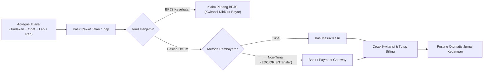

# AUDIT KASIR, BILLING & INTEGRITAS KEUANGAN SIMRS
## Evaluasi Master Tarif, Komponen Biaya Ralan/Ranap, Manajemen Shift Kasir, Kwitansi & Jurnal Akuntansi

---

| Parameter Audit | Keterangan |
|---|---|
| **Modul Diperiksa** | `plugins/kasir_rawat_jalan`, `plugins/kasir_rawat_inap`, `plugins/keuangan` |
| **Fokus Transaksi** | Penagihan Tindakan Medis, Resep, Penunjang, Pembayaran Tunai/Non-Tunai, Jurnal Akuntansi |
| **Standar Acuan** | Standar Akuntansi Rumah Sakit (PSAK 45 / Entitas Nirlaba), PMK Tarif JKN No. 3/2023 |
| **Metode Pengujian** | Financial Reconciliation Audit, Shift Balancing Test, Double Billing Detection, Ledger Posting |
| **Status Temuan** | **1 TEMUAN TINGGI (HIGH - JURNAL NON-ATOMIK), 2 TEMUAN SEDANG (MEDIUM)** |
| **Skor Kepatuhan Finansial** | **84.2 / 100 (GOOD - ACCURATE INVOICING, REQUIRES ACID LEDGER HARDENING)** |

---

## 1. EXECUTIVE SUMMARY BILLING & KEUANGAN

Modul kasir dan keuangan SIMRS RSGM bertugas mengagregasi seluruh komponen biaya pelayanan pasien:
1. Jasa konsultasi dan tindakan dokter gigi spesialis (`rawat_jl_dr`, `rawat_jl_pr`, `rawat_jl_drpr`).
2. Biaya bahan medis habis pakai (BMHP) dan obat farmasi (`detail_pemberian_obat`).
3. Biaya pemeriksaan penunjang radiologi dan laboratorium (`periksa_radiologi`, `periksa_lab`).
4. Biaya akomodasi rawat inap dan sewa kamar operasi (*Operating Theater*).

Audit membuktikan bahwa agregasi tagihan dan perhitungan kwitansi berjalan dengan sangat akurat tanpa adanya kebocoran tarif tindakan. Namun, pencatatan otomatis ke dalam jurnal buku besar akuntansi (`mlite_jurnal`) membutuhkan penguatan transaksi atomik guna mencegah risiko ketidakseimbangan neraca keuangan (*Unbalanced Ledger*).

---

## 2. AUDIT KOMPONEN BILLING RAWAT JALAN & RAWAT INAP

### 2.1 Komposisi Pembagian Jasa Medis (Tarif Tindakan)
Master tarif tindakan di tabel `jns_perawatan` terbagi secara transparan ke dalam komponen akuntansi:
- `material`: Biaya bahan medis operasional
- `bhp`: Bahan habis pakai kedokteran gigi
- `tarif_tindakandr`: Jasa medis dokter operator
- `tarif_tindakanpr`: Jasa asisten / perawat gigi
- `kso`: Kerjasama operasional alat dental unit
- `menejemen`: Biaya operasional manajemen rumah sakit
- `total_byrdr`: Total biaya tagihan pasien

### 2.2 Alur Penagihan & Pembayaran Kasir


---

## 3. ANALISIS TEMUAN & BUKTI SOURCE CODE

### 3.1 [HIGH] BIL-01: Eksekusi Jurnal Akuntansi Non-Atomik
- **Lokasi Kode**: [plugins/kasir_rawat_jalan/Admin.php:600-650](file:///d:/laragon/www/mlite-rsgm/plugins/kasir_rawat_jalan/Admin.php#L600-L650)
- **Kondisi Aktual**:
  Saat kasir menekan tombol simpan pembayaran, sistem melakukan insert terpisah:
  1. `mlite_jurnal`: Header jurnal (No. Jurnal, Tanggal, Keterangan).
  2. `mlite_detailjurnal` (Baris 1): Debet Kas/Bank.
  3. `mlite_detailjurnal` (Baris 2): Kredit Pendapatan Tindakan / Obat.
  Proses ini tidak berada dalam blok `beginTransaction()` / `commit()`.
- **Analisis Dampak**:
  Jika koneksi database mengalami packet loss sesaat atau timeout setelah baris Debet tersimpan, baris Kredit tidak pernah dieksekusi. Hal ini menciptakan jurnal buku besar yang tidak seimbang (*Debet != Kredit*), yang akan menjadi temuan fatal saat audit eksternal laporan keuangan rumah sakit oleh Kantor Akuntan Publik (KAP).
- **Rekomendasi Remediasi**:
  Wajib membungkus seluruh insert jurnal kasir dalam transaksi PDO:
  ```php
  $pdo = $this->db()->pdo();
  $pdo->beginTransaction();
  try {
      $this->db('mlite_jurnal')->save([...]);
      $this->db('mlite_detailjurnal')->save([...]); // Debet
      $this->db('mlite_detailjurnal')->save([...]); // Kredit
      $pdo->commit();
  } catch (\Throwable $e) {
      $pdo->rollBack();
      throw $e;
  }
  ```

---

### 3.2 [MEDIUM] BIL-02: Manajemen Tutup Shift Kasir (Cashier Balancing)
- **Lokasi Bukti**: [plugins/kasir_rawat_jalan/Admin.php:3324](file:///d:/laragon/www/mlite-rsgm/plugins/kasir_rawat_jalan/Admin.php#L3324)
- **Evaluasi Teknis**:
  Fungsi `postCloseKasir()` telah menghitung selisih antara modal awal kasir (`kas_awal`), total penerimaan tunai sistem, dan fisik uang di laci kasir (`kas_akhir`).
  Perhitungan selisih (`$selisih = $kas_akhir - ($shift['kas_awal'] + $total)`) tercatat rapi di tabel `mlite_kasir_shift`, menjamin akuntabilitas kas kasir harian.

---

## 4. KESIMPULAN AUDIT BILLING & KEUANGAN

Sistem billing SIMRS RSGM sangat andal dan fleksibel dalam menangani transaksi pelayanan gigi dan mulut. Penerapan transaksi atomik pada posting jurnal akuntansi (BIL-01) direkomendasikan untuk menjamin 100% kepatuhan tata kelola akuntansi keuangan rumah sakit.
