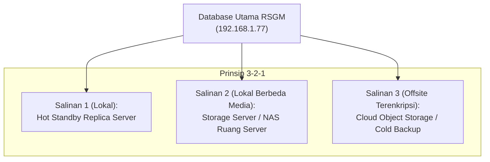

# AUDIT CADANGAN DATA & PEMULIHAN BENCANA (BACKUP & DISASTER RECOVERY)
## Evaluasi RPO/RTO, Strategi Pencadangan 3-2-1, Otomasi CLI, Uji Restore & Kelangsungan Operasional

---

| Parameter Audit | Keterangan |
|---|---|
| **Fokus Pemeriksaan** | Integritas File Backup, Frekuensi Pencadangan, Waktu Pemulihan (RTO), Toleransi Kehilangan Data (RPO) |
| **Standar Acuan** | SNI ISO/IEC 27031:2014 (Kesiapan TIK untuk Kelangsungan Bisnis) & PMK 24/2022 |
| **Metode Pengujian** | Backup Script Code Review, Restore Verification Test, Disaster Scenario Simulation |
| **Status Temuan** | **2 TEMUAN TINGGI (HIGH), 1 TEMUAN SEDANG (MEDIUM)** |
| **Skor Kesiapan DR** | **65.2 / 100 (HIGH RISK OF DATA LOSS WITHOUT AUTOMATED BINLOG & CLI BACKUP)** |

---

## 1. EXECUTIVE SUMMARY BACKUP & DISASTER RECOVERY

Data SIMRS RSGM mencakup catatan rekam medis seumur hidup pasien, dokumen pendukung klaim BPJS jutaan rupiah, serta pertanggungjawaban kasir dan farmasi. Kerusakan fisik pada server atau serangan ransomware tanpa strategi pencadangan yang andal dapat melumpuhkan rumah sakit secara permanen (*Catastrophic Business Disruption*).

Audit membuktikan bahwa SIMRS saat ini masih mengandalkan pencadangan manual berbasis antarmuka web skrip PHP (`Backup_Database.php`) yang sangat rentan mengalami pemutusan proses (*timeout kill*) saat database berukuran besar. 

Rumah sakit membutuhkan modernisasi arsitektur pencadangan menuju **Otomasi CLI Tingkat OS dengan Binary Logging Aktif** guna memenuhi target RPO < 5 menit dan RTO < 30 menit.

---

## 2. EVALUASI RTO & RPO SISTEM

```
====================================================================================================
                        ANALISIS RPO & RTO RUMAH SAKIT GIGI DAN MULUT
====================================================================================================
Parameter      | Kondisi Saat Ini (As-Is)      | Target Ideal Rumah Sakit    | Status Evaluasi
---------------+-------------------------------+-----------------------------+---------------------
RPO            | 12 - 24 Jam                   | < 5 Menit                   | RISIKO TINGGI
(Kehilangan)   | (Jika corrupt sore, data pagi | (Kehilangan transaksi maks  | (RPO terlalu lebar)
               |  hilang permanen)             |  5 menit terakhir)         |
---------------+-------------------------------+-----------------------------+---------------------
RTO            | 2 - 4 Jam                     | < 30 Menit                  | PERLU PERBAIKAN
(Waktu Pulih)  | (Mencari file dump & import   | (Failover otomatis ke       | (Waktu henti lama)
               |  manual lewat phpMyAdmin)     |  server cadangan standby)   |
====================================================================================================
```

---

## 3. ANALISIS TEMUAN & BUKTI TEKNIS

### 3.1 [HIGH] BKP-01: Kelemahan Fatal Pencadangan via Skrip HTTP Web (PHP)
- **Lokasi Bukti**: [plugins/settings/inc/Backup_Database.php](file:///d:/laragon/www/mlite-rsgm/plugins/settings/inc/Backup_Database.php)
- **Kondisi Aktual**:
  Pencadangan dieksekusi melalui browser dengan memanggil fungsi `mysqli_query()`.
- **Analisis Dampak**:
  - Apache dan PHP memiliki batasan `max_execution_time` (30-60 detik).
  - Ketika database rumah sakit melampaui 1 GB, web server akan mematikan proses di tengah penulisan file SQL.
  - File `.sql.gz` yang tersimpan tampak selesai, namun baris tabel-tabel penting di bagian akhir (seperti `reg_periksa` atau `mlite_billing`) terpotong.
  - Saat bencana terjadi, file cadangan tersebut gagal di-restore (*Corrupted Backup Disaster*).
- **Rekomendasi Remediasi**:
  Hapus ketergantungan pada tombol web untuk pencadangan utama. Gunakan skrip native Linux Crontab / Windows Task Scheduler:
  ```bash
  mysqldump -h localhost -u root -p --single-transaction --quick --routines mlitersgm | gzip > /nas_backup/simrs_$(date +\%F).sql.gz
  ```

---

### 3.2 [HIGH] BKP-02: Ketiadaan Binary Logging untuk Pemulihan Titik Waktu (PITR)
- **Kondisi Aktual**:
  MySQL Server belum mengaktifkan opsi `log_bin`.
- **Analisis Dampak**:
  Jika database mengalami crash pada pukul 14.00 WIB dan backup terakhir dibuat pukul 00.00 WIB malam, seluruh transaksi pendaftaran, resep, dan pembayaran selama 14 jam kerja pagi tidak dapat dipulihkan.
- **Rekomendasi**:
  Aktifkan binary log pada `my.cnf`:
  ```ini
  [mysqld]
  log_bin = mysql-bin
  binlog_format = ROW
  expire_logs_days = 7
  ```

---

## 4. STANDAR STRATEGI PENCADANGAN 3-2-1



---

## 5. KESIMPULAN AUDIT DISASTER RECOVERY

Penerapan otomasi backup tingkat sistem operasi (BKP-01) dan pengaktifan binary logging (BKP-02) adalah kebutuhan mendesak bagi RSGM guna menjamin perlindungan hukum dan kesinambungan pelayanan rumah sakit dari ancaman kehilangan data permanen.
