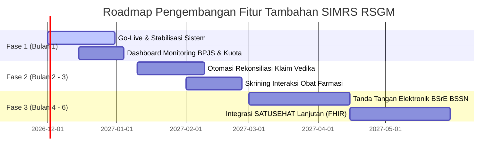

# REKOMENDASI PENGEMBANGAN FITUR TAMBAHAN SIMRS (MISSING FEATURES & ROADMAP)
## Analisis Kebutuhan Masa Depan, Otomasi Rekonsiliasi, Dashboard Eksekutif & Mitigasi Risiko Operasional

---

| Parameter Dokumen | Keterangan |
|---|---|
| **Fokus Kajian** | Analisis Kesenjangan Fitur (Gap Analysis), Rekomendasi Fitur Tambahan & Roadmap Pengembangan |
| **Prinsip Pengembangan**| "Do Not Invent Unneeded Complexities - Prioritize High-Impact Operational Safeguards" |
| **Status Prioritas** | Terbagi ke dalam Prioritas 1 (Urgent/Safety), Prioritas 2 (Efficiency), Prioritas 3 (Strategic) |

---

## 1. EXECUTIVE SUMMARY REKOMENDASI PENGEMBANGAN

Meskipun fungsi inti SIMRS RSGM telah berjalan lengkap untuk operasional klinis, audit mengidentifikasi sejumlah fitur pengawasan (*Observability & Automation*) yang akan melipatgandakan efisiensi dan keamanan operasional rumah sakit jika dikembangkan secara terencana.

Pembangunan fitur baru **TIDAK BOLEH dilakukan tergesa-gesa sebelum fase Go-Live selesai**, melainkan dijadwalkan secara bertahap pasca peluncuran operasional resmi.

---

## 2. KATALOG 10 REKOMENDASI FITUR TAMBAHAN PRIORITAS

| No | Nama Fitur yang Direkomendasikan | Alasan Kebutuhan & Nilai Tambah | Modul Terkait | Prioritas Pengembangan |
|---|---|---|---|---|
| 1 | **Dashboard Monitoring Bridging BPJS** | Menampilkan status live latency cURL BPJS, tingkat kegagalan task ID, dan kuota antrean secara real-time | `dashboard`, `jkn_mobile` | **P1 (High)** |
| 2 | **Early Warning Kuota Dokter (Alert 85%)**| Notifikasi otomatis ke staf admisi dan kepala poli saat kuota dokter spesialis mencapai 85% dan 95% | `antrian`, `pasien` | **P1 (High)** |
| 3 | **Modul Otomasi Rekonsiliasi Klaim** | Pencocokan otomatis satu klik antara daftar SEP terbit di VClaim dengan data registrasi SIMRS | `vedika`, `vclaim` | **P2 (Medium)** |
| 4 | **Circuit Breaker Service BPJS** | Mencegah aplikasi freeze saat server BPJS mengalami perlambatan ekstrem | `systems/lib/BpjsService` | **P1 (High)** |
| 5 | **Skrining Interaksi Obat Otomatis** | Memperingatkan dokter saat menuliskan kombinasi obat yang berisiko kontraindikasi | `farmasi`, `dokter_ralan`| **P2 (Medium)** |
| 6 | **Tanda Tangan Elektronik BSrE BSSN** | Integrasi digital signature resmi tersertifikasi untuk resume medis & informed consent | `form_rme`, `pasien` | **P3 (Strategic)** |
| 7 | **Modul Disaster Recovery Down-Time** | Antarmuka offline darurat berbasis SQLite lokal jika jaringan intranet putus total | `systems/Site.php` | **P3 (Strategic)** |
| 8 | **Pelacakan Waktu Tunggu Layanan (SLA)**| Pelacak durasi pelayanan per pasien dari loket hingga apotek dengan indikator warna merah | `antrian`, `laporan` | **P2 (Medium)** |
| 9 | **Otomasi Pembersihan Berkas Yatim** | Script background untuk membersihkan file upload sampah yang tidak berelasi di DB | `settings`, `master` | **P3 (Maintenance)** |
| 10| **Integrasi Notifikasi WhatsApp Pasien**| Pengiriman nomor antrean dan pengingat jadwal kontrol gigi otomatis via WA Gateway | `wagateway`, `antrian` | **P2 (Medium)** |

---

## 3. ROADMAP PENGEMBANGAN PASCA GO-LIVE (TIMELINE 6 BULAN)

---

## 4. KESIMPULAN

Rekomendasi fitur tambahan ini dirancang untuk memperkuat tata kelola rumah sakit gigi dan mulut dalam jangka panjang tanpa mengganggu fokus utama persiapan Go-Live operasional.
