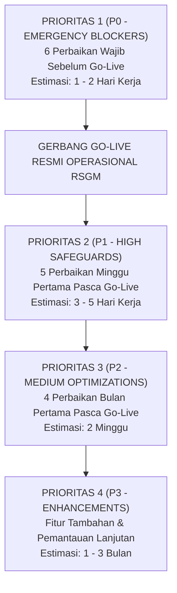

# RENCANA AKSI PERBAIKAN & REMEDIASI SIMRS (MASTER ACTION PLAN)
## Prioritas Perbaikan, Estimasi Waktu, Rencana Rollback, Mitigasi Risiko & Acceptance Criteria

---

| Parameter Dokumen | Keterangan |
|---|---|
| **Fokus Dokumen** | Rencana Implementasi Perbaikan Menyeluruh Berdasarkan Temuan Audit Komprehensif |
| **Metode Pelaksanaan** | Bertahap (Phased Rollout), Teruji (Regression Tested), Rollback Ready |
| **Struktur Prioritas** | Prioritas 1 (P0 - Emergency Blockers), Prioritas 2 (P1 - High), Prioritas 3 (P2 - Medium), Prioritas 4 (P3 - Polish) |

---

## 1. STRUKTUR MASTER ACTION PLAN



---

## 2. DETAIL PERBAIKAN PRIORITAS 1 (P0 - EMERGENCY BLOCKERS)

Perbaikan ini **WAJIB DISELESAIKAN** sebelum sistem menerima beban operasional pasien nyata:

### 2.1 P0-1: Matikan Mode Developer (`DEV_MODE = false`)
- **File Diubah**: [config.php](file:///d:/laragon/www/mlite-rsgm/config.php#L110)
- **Tindakan**: Ubah baris 110 menjadi `define('DEV_MODE', false);`.
- **Risiko Perubahan**: Nol.
- **Rencana Rollback**: Kembalikan ke `true` jika terjadi error yang perlu di-debug.
- **Acceptance Criteria**: Saat halaman sengaja di-trigger error, layar hanya menampilkan pesan ramah tanpa jejak stack trace teknis.

### 2.2 P0-2: Rotasi Kunci Rahasia JWT (`JWT_SECRET`)
- **File Diubah**: [config.php](file:///d:/laragon/www/mlite-rsgm/config.php#L112)
- **Tindakan**: Ganti `'mlite_secret_key_change_me'` dengan string acak 64 karakter dari `bin2hex(random_bytes(32))`.
- **Risiko Perubahan**: Token API lama yang masih aktif akan expired (wajib re-login).
- **Rencana Rollback**: Kembalikan string sebelumnya jika ada integrasi eksternal yang terputus.
- **Acceptance Criteria**: Verifikasi token JWT lama ditolak oleh `checkAuth()`.

### 2.3 P0-3: Proteksi Direktori Unggahan (`uploads/.htaccess`)
- **File Dibuat**: `uploads/.htaccess`
- **Tindakan**: Tulis aturan penonaktifan PHP engine dan pemblokiran eksekusi file skrip.
- **Risiko Perubahan**: Nol terhadap file gambar atau PDF yang valid.
- **Acceptance Criteria**: Akses langsung via browser ke file `.php` di folder uploads menghasilkan HTTP 403 Forbidden.

### 2.4 P0-4: Patch Path Traversal Penghapusan Berkas Digital
- **File Diubah**: [plugins/pasien/Admin.php:736](file:///d:/laragon/www/mlite-rsgm/plugins/pasien/Admin.php#L736)
- **Tindakan**: Terapkan `basename()` dan validasi token CSRF pada `postHapusBerkasDigital()`.
- **Risiko Perubahan**: Sangat rendah.
- **Acceptance Criteria**: Request penghapusan dengan payload `../../` ditolak sistem.

### 2.5 P0-5: Patch SQL Injection pada Modul Laporan Kunjungan
- **File Diubah**: [plugins/laporan/Admin.php:1475](file:///d:/laragon/www/mlite-rsgm/plugins/laporan/Admin.php#L1475)
- **Tindakan**: Ganti penggabungan string `$startDate` dengan parameter binding PDO `:tgl_awal`.
- **Risiko Perubahan**: Rendah.
- **Acceptance Criteria**: Input karakter kutip tunggal `'` pada filter tanggal tidak memicu error sintaks SQL.

### 2.6 P0-6: Penambahan Indeks Kritis `reg_periksa.tgl_registrasi`
- **Database Terdampak**: Tabel `reg_periksa` di database `mlitersgm`.
- **Tindakan DDL**:
  ```sql
  ALTER TABLE `reg_periksa` ADD INDEX `idx_tgl_registrasi` (`tgl_registrasi`);
  ALTER TABLE `reg_periksa` ADD INDEX `idx_tgl_poli_dokter` (`tgl_registrasi`, `kd_poli`, `kd_dokter`);
  ```
- **Risiko Perubahan**: Penguncian tabel sesaat selama penambahan indeks (jalankan di luar jam pelayanan).
- **Rencana Rollback**: `ALTER TABLE reg_periksa DROP INDEX idx_tgl_registrasi;`
- **Acceptance Criteria**: Perintah `EXPLAIN` query harian menunjukkan `type: ref` dan waktu eksekusi < 10ms.

---

## 3. DETAIL PERBAIKAN PRIORITAS 2 (P1 - HIGH SAFEGUARDS)

Dikerjakan pada **Minggu Pertama Pasca Go-Live**:

| Kode | Deskripsi Perbaikan | File Diubah | Dampak & Kriteria Penerimaan |
|---|---|---|---|
| **P1-1** | Normalisasi Formula Timestamp BPJS | `systems/lib/BpjsService.php`, `plugins/icare/Admin.php` | Mengubah formula menjadi `strval(time())` guna mengeliminasi selisih 7 jam di WIB. |
| **P1-2** | Ubah RBAC Menjadi Fail-Closed | `systems/Main.php:895` | Mengubah `if (!$mlite_crud_permissions) return true;` menjadi `return false;`. |
| **P1-3** | Regenerasi Sesi Saat Login Sukses | `systems/Admin.php:660` | Menambahkan `session_regenerate_id(true)` untuk mematikan risiko Session Fixation. |
| **P1-4** | Ubah `ON DELETE CASCADE` Rekam Medis | DDL Database `mlite_db.sql` | Mengubah FK `pemeriksaan_ralan` ke `ON DELETE RESTRICT` agar rekam medis terlindungi. |
| **P1-5** | Atomisitas Transaksi Jurnal Kasir | `plugins/kasir_rawat_jalan/Admin.php` | Membungkus insert debet-kredit dalam blok `beginTransaction()` / `commit()`. |

---

## 4. DETAIL PERBAIKAN PRIORITAS 3 & 4 (P2 & P3)

- **P2-1 (Bulan 1)**: Konfigurasi Master-Replica MySQL Replication untuk mencapai target RPO < 5 menit.
- **P2-2 (Bulan 1)**: Migrasi pencadangan web PHP ke OS Crontab native `mysqldump`.
- **P2-3 (Bulan 1)**: Standardisasi charset tabel database ke `utf8mb4_unicode_ci`.
- **P3-1 (Bulan 2 - 3)**: Pembangunan widget live monitoring BPJS pada dashboard admin.
- **P3-2 (Bulan 2 - 3)**: Integrasi Tanda Tangan Elektronik resmi BSrE BSSN.

---

## 5. KESIMPULAN RENCANA AKSI

Rencana aksi ini dirancang dengan pendekatan bedah presisi (*Surgical Precision*): fokus mematikan celah kritis terlebih dahulu agar operasional rumah sakit dapat segera berjalan dengan aman, lalu melanjutkan peningkatan tata kelola jangka panjang tanpa mengganggu kenyamanan pelayanan dokter dan pasien.
