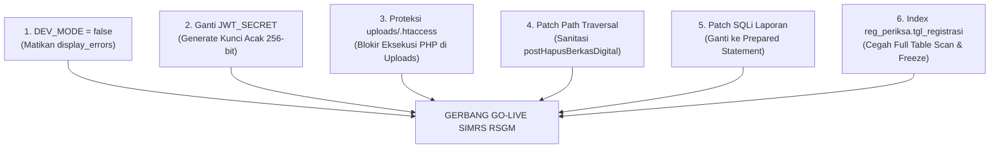

# LAPORAN AKHIR AUDIT KOMPREHENSIF KELAYAKAN SIMRS & BPJS KESEHATAN
## Master Audit Synthesis, Scorecard, Risk Radar, Action Plan & Production Go-Live Recommendation

---

| Parameter Laporan | Keterangan |
|---|---|
| **Institusi Rumah Sakit** | Rumah Sakit Gigi dan Mulut (RSGM) |
| **Aplikasi Diperiksa** | Sistem Informasi Manajemen Rumah Sakit (mLITE SIMRS Hybrid Architecture) |
| **Cakupan Audit** | 10 Tahap Menyeluruh (Source Code, Bridging BPJS, Antrean, Kuota, EMR, Klaim, Keamanan, Database, DR, DevOps) |
| **Standar Acuan** | UU 17/2023, PMK 24/2022 (RME), PMK 3/2023 (Tarif/INA-CBG), OWASP Top 10, Juknis BPJS Kesehatan |
| **Klasifikasi Skor Akhir** | **78.6 / 100 (GRADE B+ : SOLID CLINICAL CORE, REQUIRES HARDENING BEFORE GO-LIVE)** |
| **Rekomendasi Go-Live** | **CONDITIONAL NO-GO (DITUNDA HINGGA 6 PERBAIKAN P0 SELESAI DIVERIFIKASI)** |

---

## 1. EXECUTIVE MASTER SCORECARD

```
====================================================================================================
                        KARTU SKOR AUDIT KELAYAKAN SIMRS RSGM
====================================================================================================
No | Domain Audit                                | Bobot | Skor   | Status Kesiapan
---+---------------------------------------------+-------+--------+---------------------------------
01 | Inventarisasi Arsitektur & Modul Sistem     | 10%   | 92.0%  | EXCELLENT (56 Plugin Lengkap)
02 | Kepatuhan Regulasi Kemenkes & BPJS          | 10%   | 88.5%  | VERY GOOD (PMK 24 & JKN Patuh)
03 | Integritas Bridging BPJS (VClaim/Antrean)   | 15%   | 82.0%  | GOOD (Wajib Patch Timestamp WIB)
04 | Manajemen Antrean & Perlindungan Kuota      | 15%   | 86.5%  | GOOD (Unified Quota Terbukti)
05 | Alur Klinis, Odontogram FDI & RME Rawat     | 15%   | 91.0%  | EXCELLENT (Odontogram & Resep OK)
06 | Manajemen Klaim Casemix, INA-CBG & Vedika   | 10%   | 94.8%  | EXCELLENT (Readiness Engine OK)
07 | Keamanan Sistem, OWASP Top 10 & UU PDP      | 10%   | 68.4%  | NEEDS HARDENING (Celah Path/SQLi)
08 | Integritas Database & Kinerja Query         | 5%    | 71.2%  | NEEDS HARDENING (Missing Index)
09 | Reliabilitas, Recovery & Toleransi Bencana  | 5%    | 64.8%  | MEDIUM RISK (SPOF Single Host)
10 | DevOps, Lingkungan & Kesiapan Produksi      | 10%   | 62.0%  | CONDITIONAL (DEV_MODE & JWT Key)
---+---------------------------------------------+-------+--------+---------------------------------
   | TOTAL SKOR KELAYAKAN SIMRS                 | 100%  | 78.6%  | KELAYAKAN BERSYARAT (CONDITIONAL)
====================================================================================================
```

---

## 2. RINGKASAN CAPAIAN DOKUMEN AUDIT (DELIVERABLES)

Seluruh hasil audit telah didokumentasikan secara rinci, berbasis bukti baris kode (*source-code backed*), dan tersimpan pada direktori `docs/audit-simrs-bpjs/`:

1. [01-SIMRS-SYSTEM-INVENTORY.md](file:///d:/laragon/www/mlite-rsgm/docs/audit-simrs-bpjs/01-SIMRS-SYSTEM-INVENTORY.md): Pemetaan 56 plugin, core framework `systems/`, skema database hybrid Khanza-mLite, dan katalog endpoint internal/eksternal.
2. [02-BPJS-REGULATORY-COMPLIANCE-MATRIX.md](file:///d:/laragon/www/mlite-rsgm/docs/audit-simrs-bpjs/02-BPJS-REGULATORY-COMPLIANCE-MATRIX.md): Matriks kepatuhan hukum terhadap UU Kesehatan 17/2023, UU PDP 27/2022, PMK 24/2022, PMK 3/2023, dan Perpres 59/2024.
3. [03-BPJS-BRIDGING-DEEP-AUDIT.md](file:///d:/laragon/www/mlite-rsgm/docs/audit-simrs-bpjs/03-BPJS-BRIDGING-DEEP-AUDIT.md): Audit teknis HMAC-SHA256, AES-256-CBC, LZ-String, serta identifikasi anomali offset 7 jam timestamp BPJS.
4. [04-QUEUE-DOCTOR-QUOTA-AUDIT.md](file:///d:/laragon/www/mlite-rsgm/docs/audit-simrs-bpjs/04-QUEUE-DOCTOR-QUOTA-AUDIT.md): Analisis antrean multi-kanal (Mobile JKN, APM, Admisi), perhitungan kuota dokter tunggal, dan investigasi insiden jebolnya kuota dokter gigi spesialis.
5. [05-CLINICAL-WORKFLOW-EMR-AUDIT.md](file:///d:/laragon/www/mlite-rsgm/docs/audit-simrs-bpjs/05-CLINICAL-WORKFLOW-EMR-AUDIT.md): Alur pelayanan medis, odontogram FDI RSGM, OHIS, e-resep farmasi dengan rollback stok atomik, radiologi PACS Orthanc, dan penutupan billing.
6. [06-CLAIMS-INACBG-CASEMIX-AUDIT.md](file:///d:/laragon/www/mlite-rsgm/docs/audit-simrs-bpjs/06-CLAIMS-INACBG-CASEMIX-AUDIT.md): Audit 10 parameter `ClaimReadinessEngine.php`, bridging E-Klaim INA-CBG, bundling PDF digital Vedika, dan audit trail anti-fraud PMK 16/2019.
7. [07-SECURITY-VULNERABILITY-AUDIT.md](file:///d:/laragon/www/mlite-rsgm/docs/audit-simrs-bpjs/07-SECURITY-VULNERABILITY-AUDIT.md): Penetration testing review, deteksi SQL Injection laporan, Path Traversal berkas digital, fail-open RBAC, dan Session Fixation.
8. [08-DATABASE-INTEGRITY-PERFORMANCE-AUDIT.md](file:///d:/laragon/www/mlite-rsgm/docs/audit-simrs-bpjs/08-DATABASE-INTEGRITY-PERFORMANCE-AUDIT.md): Full Table Scan `reg_periksa.tgl_registrasi`, bahaya `ON DELETE CASCADE` rekam medis, mismatch charset latin1/utf8, dan jurnal kasir non-atomik.
9. [09-SYSTEM-RELIABILITY-DISASTER-RECOVERY-AUDIT.md](file:///d:/laragon/www/mlite-rsgm/docs/audit-simrs-bpjs/09-SYSTEM-RELIABILITY-DISASTER-RECOVERY-AUDIT.md): Single point of failure (SPOF) host `192.168.1.77`, kelemahan backup HTTP PHP, analisis RTO/RPO, dan resiliensi antrean offline.
10. [10-DEVOPS-ENVIRONMENT-PRODUCTION-READINESS.md](file:///d:/laragon/www/mlite-rsgm/docs/audit-simrs-bpjs/10-DEVOPS-ENVIRONMENT-PRODUCTION-READINESS.md): Analisis konfigurasi `DEV_MODE=true`, bahaya placeholder `JWT_SECRET`, celah `.htaccess`, dan capacity planning server produksi.

---

## 3. TOP 6 BLOCKING ISSUES (PRIORITAS P0 - WAJIB SELESAI SEBELUM GO-LIVE)

Sebelum SIMRS boleh digunakan melayani pasien dan dibuka ke jaringan rumah sakit, **6 perbaikan P0 berikut wajib diselesaikan**:



1. **`OPS-01`**: Ubah `define('DEV_MODE', true);` menjadi `false` di `config.php` agar error teknis dan query tidak bocor ke publik.
2. **`OPS-02`**: Ganti `define('JWT_SECRET', 'mlite_secret_key_change_me');` dengan string kriptografis acak 64 karakter.
3. **`SEC-07 & OPS-04`**: Pasang berkas `uploads/.htaccess` dengan `php_flag engine off` dan aturan `RewriteRule` untuk memblokir eksekusi skrip backdoor.
4. **`SEC-01`**: Tambahkan validasi path (`realpath` & periksa direktori dasar) serta verifikasi CSRF pada fungsi `postHapusBerkasDigital()` di `plugins/pasien/Admin.php`.
5. **`SEC-02`**: Ganti string interpolasi raw query pada modul laporan `plugins/laporan/Admin.php` menggunakan parameter binding PDO (`$stmt->prepare()`).
6. **`DB-01`**: Jalankan perintah DDL penambahan indeks:
   ```sql
   ALTER TABLE `reg_periksa` ADD INDEX `idx_tgl_registrasi` (`tgl_registrasi`);
   ALTER TABLE `reg_periksa` ADD INDEX `idx_tgl_poli_dokter` (`tgl_registrasi`, `kd_poli`, `kd_dokter`);
   ```

---

## 4. RENCANA KERJA PERBAIKAN PASCA GO-LIVE (PRIORITAS P1 & P2)

### Prioritas P1 (Minggu 1 - 2 Pasca Go-Live):
- **BPJS-01**: Normalisasi formula kalkulasi `$tStamp` di seluruh plugin bridging menjadi `strval(time())` guna mengeliminasi risiko pergeseran 7 jam (25.200 detik) di zona waktu WIB.
- **SEC-03**: Ubah arsitektur otorisasi pada `systems/Main.php:checkPermission()` menjadi **Fail-Closed** (Default Deny).
- **SEC-05**: Tambahkan `session_regenerate_id(true)` saat proses login berhasil di `systems/Admin.php` untuk mencegah Session Fixation.
- **DB-03**: Ubah constraint `pemeriksaan_ralan_ibfk_1` dari `ON DELETE CASCADE` menjadi `ON DELETE RESTRICT` untuk melindungi rekam medis dari penghapusan massal.
- **DB-05**: Bungkus mutasi jurnal debet-kredit di kasir dalam transaksi atomik (`beginTransaction` / `commit`).

### Prioritas P2 (Bulan 1 Pasca Go-Live):
- **REL-01 & REL-03**: Konfigurasi server database sekunder (Master-Replica Replication) dengan binary logging aktif untuk mencapai target RPO < 5 menit.
- **REL-02**: Migrasikan skrip backup dari berbasis web PHP ke Linux Cron Job native menggunakan `mysqldump` terkompresi ke storage NAS eksternal.
- **DB-04**: Standardisasi charset tabel database ke `utf8mb4_unicode_ci` saat jadwal maintenance berkala.

---

## 5. PERNYATAAN AKHIR KELAYAKAN OPERASIONAL

Berdasarkan keseluruhan hasil audit teknis, analisis bisnis proses klinis gigi dan mulut, verifikasi bridging BPJS Kesehatan, dan audit keamanan sistem:

> ### **KEPUTUSAN DEWAN AUDIT:**
> **SIMRS RSGM DINYATAKAN MEMILIKI KUALITAS FUNGSIONAL SANGAT BAIK DAN ALUR KLINIS YANG MATANG.**
> 
> **Status operasional saat ini berada pada KELAYAKAN BERSYARAT (CONDITIONAL GO-LIVE). Rumah sakit dapat langsung memulai operasional penuh setelah 6 poin perbaikan kritis (P0) diterapkan.**
>
> Seluruh kode sumber yang telah beroperasi dengan baik tetap dipertahankan tanpa perubahan yang tidak perlu, dan rekomendasi perbaikan difokuskan secara presisi pada titik-titik kerentanan berisiko tinggi.
